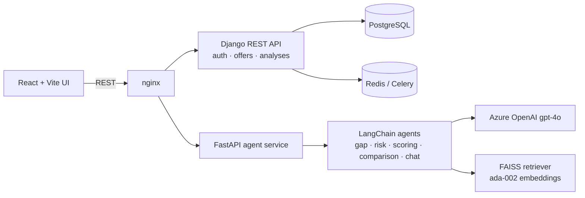

# ClarityChains — AI Procurement Offer Analysis

**Live demo:** https://clarity-chains.vercel.app

ClarityChains helps procurement teams compare supplier offers. Upload the offer documents (PDF, DOCX, XLSX, CSV) for each supplier. A chain of LLM agents extracts the commercial terms, flags gaps and risks, scores every supplier against weighted criteria, and produces an executive recommendation you can question in a chat.

## Features

- **Multi-format ingestion**: PDF, Word, Excel, CSV and text offers, grouped per supplier
- **Gap analysis**: TCO, payment terms, price stability, lead time, technical specs, certifications, Incoterms, warranty, deviations
- **Risk analysis** with configurable risk weights
- **Weighted scoring**: user-defined criteria weights (e.g. TCO 25%, lead time 20%, ...)
- **Supplier comparison and executive report**, including arithmetic checks such as a quoted total that doesn't match the line items
- **Chat over the analysis**: follow-up questions answered from the analysis JSON plus a FAISS retriever over the source documents
- **RFx creation** flow and procurement dashboard in the web app

## Architecture



| Service | Stack | Path |
|---|---|---|
| Frontend | React 18, TypeScript, Vite, Tailwind, shadcn/ui, Recharts | `frontend/` |
| Backend | Django 4.2, DRF, SimpleJWT, PostgreSQL, Redis, Celery | `backend/` |
| Agent | FastAPI, LangChain, Azure OpenAI, FAISS | `agent/` |
| Edge | nginx reverse proxy | `nginx/` |

### Agent API (`agent/main.py`)

| Endpoint | Purpose |
|---|---|
| `POST /api/process-files` | parse uploaded offer files |
| `POST /api/add-offer` | add a supplier offer to the session |
| `POST /api/analyze` | run gap, risk, scoring and final report with the given weights |
| `GET /api/comparison-summary` | cross-supplier comparison |
| `POST /api/chat` | Q&A over the analysis |
| `GET /health` | health check |

## Run locally

```bash
cp .env.example .env     # add your Azure OpenAI endpoint + key
make build && make up    # or: docker compose up --build
```

- UI: http://localhost:3000
- Django API: http://localhost:8000/api/
- Agent API: http://localhost:8001 (docs at `/docs`)

Other targets: `make logs`, `make migrate`, `make test`, `make down`. Run `make help` to see them all.

## Related

- [claritychains-model](https://github.com/OnsKoukiPro/claritychains-model): earlier prototype with critical-materials price forecasting, supplier diversification and hedging models (Streamlit)
